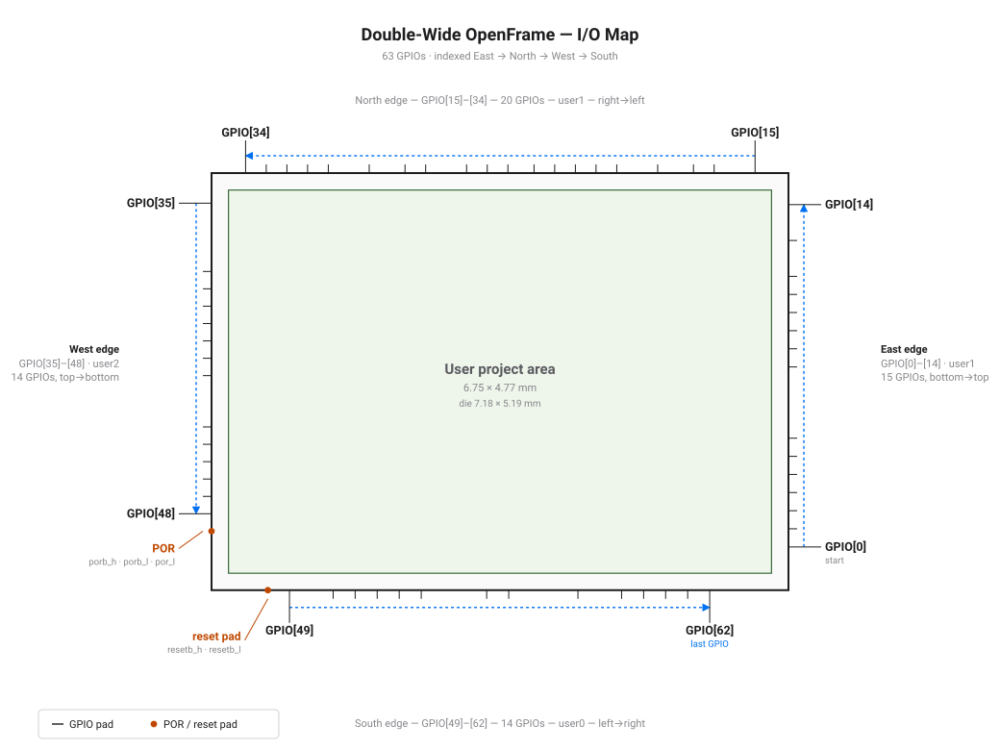
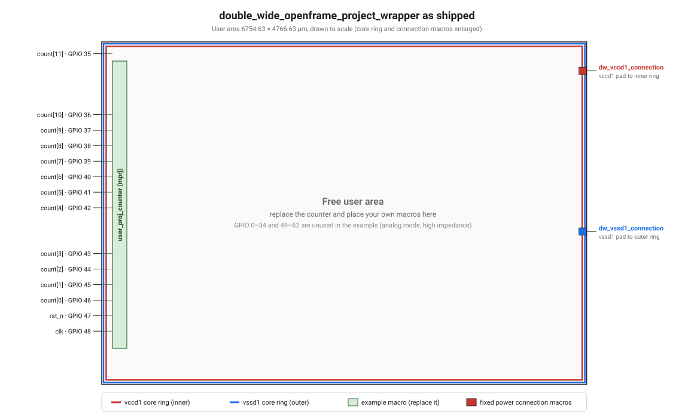

<div align="center">


[](https://git.io/typing-svg)

[](https://opensource.org/licenses/Apache-2.0)
[](https://platform.chipfoundry.io/marketplace)

</div>

# Double-Wide OpenFrame User Project

This is the starting point for a chip on the ChipFoundry **Double-Wide OpenFrame**: a sky130 padframe with no management SoC, a **32 mm² user area** and **63 GPIOs** that are all yours. You put your design inside one module, `double_wide_openframe_project_wrapper`, harden it, and ChipFoundry swaps it into the padframe.

The template is complete and already hardened, so every step of the flow works right after cloning.

> [!IMPORTANT]
> The design in this repository is a 12-bit counter. It is **only an example** of how to use the wrapper: how to hook a macro to the GPIOs, the frame resets and the power grid. Replace it with your own design. The two power connection macros (`dw_vccd1_connection`, `dw_vssd1_connection`) are not part of the example: they stay in every wrapper. See [Power](#power-the-vccd1-and-vssd1-connection-macros).

## Contents

- [The Double-Wide OpenFrame at a glance](#the-double-wide-openframe-at-a-glance)
- [Quick start](#quick-start)
- [What the template contains](#what-the-template-contains)
- [Replacing the counter with your design](#replacing-the-counter-with-your-design)
- [Power: the vccd1 and vssd1 connection macros](#power-the-vccd1-and-vssd1-connection-macros)
- [Rules the wrapper must follow](#rules-the-wrapper-must-follow)
- [Documentation](#documentation)
- [Checklist for shuttle submission](#checklist-for-shuttle-submission)

## The Double-Wide OpenFrame at a glance

| | Double-Wide OpenFrame | OpenFrame |
| :--- | :--- | :--- |
| Die | 7176 × 5188 µm | 3588 × 5188 µm |
| User area | **6754.63 × 4766.63 µm (~32 mm²)** | ~15 mm² |
| GPIOs | **63** (`gpio[62:0]`) | 44 |
| Management SoC | none | none |
| Wrapper module | `double_wide_openframe_project_wrapper` | `openframe_project_wrapper` |
| Process | SkyWater sky130A | SkyWater sky130A |

It is the OpenFrame made twice as wide. The west and east pad columns are the OpenFrame's own; the north and south rows are the OpenFrame's rows placed twice, side by side. Each pad has the same interface as on the OpenFrame, and the frame also gives your design a power-on reset, a master reset pad and a constant one and zero next to every pad.



Full details: [docs/double_wide.md](docs/double_wide.md).

## Quick start

This takes the shipped example through the whole flow. Nothing needs editing.

**You need:** Git, Python 3.8+ with `pip`, [Docker](https://docs.docker.com/get-docker/) (simulation and precheck) and [Nix](https://librelane.readthedocs.io) (hardening). For this project type `cf harden` runs only through Nix; `--use-docker` is refused.

**1. Create your repository** from this template on GitHub ("Use this template"), then clone it and install the ChipFoundry CLI:

```bash
git clone <your-github-repo-URL>
```

```bash
cd <your-repo>
```

```bash
pip install chipfoundry-cli
```

**2. Initialize the project.** Accept `double_wide` when asked for the project type (it is detected from the wrapper GDS):

```bash
cf init
```

This writes `.cf/project.json`, which every other command reads. If you are logged in (`cf login`), it also offers to link the repository to a project on the [ChipFoundry platform](https://platform.chipfoundry.io).

**3. Install the tools and the frame:**

```bash
cf setup
```

This puts the Double-Wide OpenFrame harness in `caravel/`, the sky130 PDK in `dependencies/pdks/`, and installs the cocotb simulation environment and `cf-precheck`.

**4. Simulate the example** at chip level, through the real pad models:

```bash
cf verify counter
```

**5. Harden** the example macro, then the wrapper that contains it:

```bash
cf harden user_proj_counter
```

```bash
cf harden double_wide_openframe_project_wrapper
```

The hardened views are already committed, so you can skip this step the first time through and come back to it once you have changed something.

**6. Run the gate-level simulation and the precheck:**

```bash
cf verify counter --sim gl
```

```bash
cf precheck
```

If all of that passes, your environment is sound and you can start on your own design.

## What the template contains



| Path | What it is | Yours to change? |
| :--- | :--- | :--- |
| `verilog/rtl/double_wide_openframe_project_wrapper.v` | The wrapper: instantiates the example macro and configures all 63 pads | Body yes. Module name and port list no |
| `verilog/rtl/user_proj_counter.v` | The example macro, a 12-bit counter | Yes, replace it |
| `verilog/rtl/CF_gpio_config.v` | Helper that sets one pad's mode (input, output, pull-up, analog...) | Use as is |
| `openlane/user_proj_counter/` | LibreLane configuration of the example macro | Yes, replace it |
| `openlane/double_wide_openframe_project_wrapper/config.json` | LibreLane configuration of the wrapper | Partly, see [Rules](#rules-the-wrapper-must-follow) |
| `openlane/double_wide_openframe_project_wrapper/pin_template.def` | Position of every wrapper pin, taken from the frame | No |
| `openlane/double_wide_openframe_project_wrapper/fixed_dont_change/` | The two power connection macros and the script that places them | No |
| `verilog/dv/cocotb/` | cocotb tests run by `cf verify` | Yes |
| `verilog/includes/` | File lists `cf verify` compiles for RTL and gate-level simulation | Yes |
| `lvs/double_wide_openframe_project_wrapper/lvs_config.json` | LVS configuration for `cf precheck` | Yes, list your macros |
| `gds/`, `lef/`, `def/`, `mag/`, `lib/`, `spef/`, `verilog/gl/`, `signoff/` | Hardened views written by `cf harden` | Regenerated |
| `flake.nix` | Pins the LibreLane release `cf harden` uses (2.4.6) | No |

The example counter:

| GPIO | Use | Pad mode |
| :--- | :--- | :--- |
| 48 | clock | input |
| 47 | active-low reset | input with pull-up |
| 46 down to 35 | `count[0]` up to `count[11]` | output |
| all others | unused | analog (high impedance) |

Walk-through of how it is built: [docs/example_counter.md](docs/example_counter.md).

## Replacing the counter with your design

1. Write your RTL in `verilog/rtl/` and give each block its own `openlane/<macro>/config.json`. Start from `openlane/user_proj_counter/`.
2. Harden each macro with `cf harden <macro>`.
3. In the wrapper RTL, instantiate your macros instead of `user_proj_counter` and give **every** pad a `CF_gpio_config`, including the pads you do not use.
4. In the wrapper `config.json`, replace the `user_proj_counter` entry under `MACROS` and its `FP_PDN_MACRO_HOOKS` entry with your own. Leave the two `dw_*_connection` entries in place.
5. Update the wrapper SDC, the file lists in `verilog/includes/`, the LVS configuration and the cocotb tests.
6. Harden the wrapper, then run `cf verify --all`, `cf verify --all --sim gl` and `cf precheck`.

Step-by-step, with the exact fields to edit: [docs/your_design.md](docs/your_design.md).

## Power: the vccd1 and vssd1 connection macros

Digital logic runs on **`vccd1` / `vssd1`**. Inside the wrapper those two nets are a core ring plus a grid. The frame, however, delivers them only as short metal-3 ports on the east edge of the user area, one pad each. Something has to join the pad ports to the ring, and that is the job of the two macros in `fixed_dont_change/`:

| Macro | Joins | Placed at (µm) |
| :--- | :--- | :--- |
| `dw_vccd1_connection` | the `vccd1` pad ports to the inner ring | (6710.515, 4327.510) |
| `dw_vssd1_connection` | the `vssd1` pad ports to the outer ring | (6710.515, 2088.510) |

What you need to know:

- **They are not part of the counter example.** When you replace the counter, they stay. A wrapper without them has a power grid that is not connected to any pad.
- **You do not instantiate or place them.** `fixed_dont_change/pdn_cfg.tcl` places them while the power grid is built. The hardening log prints `Placed 2 power connection macros.`
- **Keep what they depend on:** their two `MACROS` entries, `FP_PDN_CFG`, `FP_PDN_CORE_RING_*`, `FP_DEF_TEMPLATE`, `DIE_AREA` and `CORE_AREA` in the wrapper `config.json`.
- **They fit this ring only.** If you change the core ring, drop the shipped PDN script or build the wrapper with another flow (a hand-drawn or analog top level, for example), these macros no longer land on your power grid and you have to replace them with your own connection. [docs/power.md](docs/power.md) explains how and what to check.
- The other supplies (`vccd2`/`vssd2`, `vdda`, `vdda1`, `vdda2`, `vddio`, `vccd` and their grounds) have no connection macro. They are pins on the wrapper edge; if you use one, you route to it yourself.

## Rules the wrapper must follow

- The top module is named `double_wide_openframe_project_wrapper` and has exactly the ports of `caravel/verilog/rtl/__double_wide_openframe_project_wrapper.v`.
- The footprint is 6754.63 × 4766.63 µm and every pin is where `pin_template.def` puts it. `cf precheck` compares the wrapper boundary with the frame's empty wrapper.
- Every pad's controls are driven, for all 63 GPIOs. There is no management SoC and no `user_defines.v` to do it for you, and `cf gpio-config` does not apply to this project type.
- `pin_template.def` and `fixed_dont_change/` are not edited.
- In the wrapper `config.json`, the grid pitch, width and offset (`FP_PDN_VPITCH`, `FP_PDN_VWIDTH`, `FP_PDN_VOFFSET` and the `H` equivalents), your `MACROS` entries and `FP_PDN_MACRO_HOOKS` are yours. The settings listed under [Power](#power-the-vccd1-and-vssd1-connection-macros) are not.

## Documentation

| Page | Read it for |
| :--- | :--- |
| [docs/double_wide.md](docs/double_wide.md) | The frame: geometry, GPIO numbering, power domains, resets, the wrapper's ports |
| [docs/example_counter.md](docs/example_counter.md) | How the counter example uses the wrapper |
| [docs/your_design.md](docs/your_design.md) | Replacing the example with your own design, file by file |
| [docs/power.md](docs/power.md) | The core ring, the connection macros and when they must be replaced |
| [docs/flow.md](docs/flow.md) | `cf harden`, `cf verify`, `cf precheck`, compressed views, timing constraints, troubleshooting |

From the frame's own repository, [double_wide_openframe](https://github.com/chipfoundry/double_wide_openframe):

- [Datasheet](https://github.com/chipfoundry/double_wide_openframe/blob/main/docs/datasheet.md): pad behaviour at power-up, power sequencing, integration.
- [Pinout](https://github.com/chipfoundry/double_wide_openframe/blob/main/docs/pinout.md): bond-pad coordinates of every GPIO and power pad.

## Checklist for shuttle submission

- [ ] The example counter is replaced by your design, and this README describes it.
- [ ] The top-level module is `double_wide_openframe_project_wrapper` with the unchanged port list.
- [ ] `pin_template.def`, `fixed_dont_change/`, `DIE_AREA` and `CORE_AREA` are as shipped.
- [ ] The hardening log of the wrapper says `Placed 2 power connection macros.`, or you have replaced them as described in [docs/power.md](docs/power.md).
- [ ] Every one of the 63 GPIOs is configured, including unused pads.
- [ ] All macros and the wrapper are hardened and their views are committed (large views gzipped, see [docs/flow.md](docs/flow.md#compressed-views)).
- [ ] `cf verify --all` and `cf verify --all --sim gl` pass.
- [ ] `cf precheck` passes.
