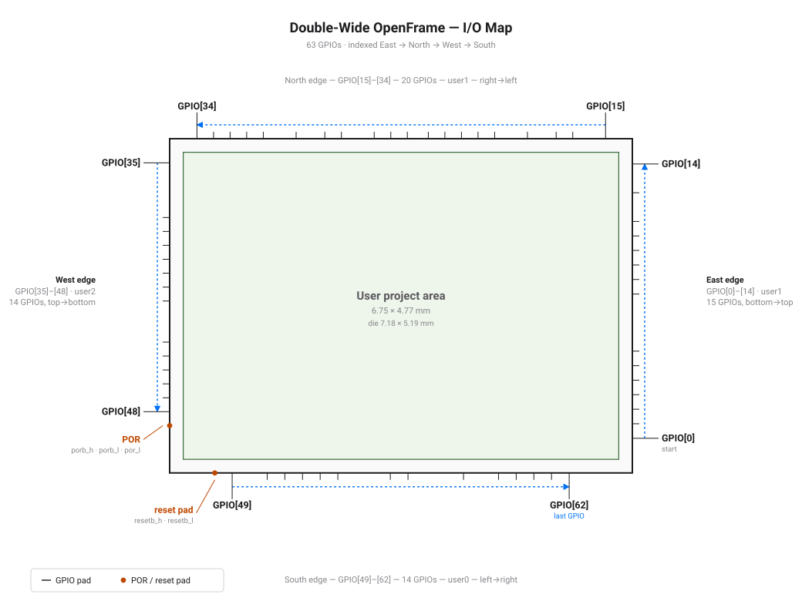

# The Double-Wide OpenFrame

What the frame gives your design, and what it expects back. The frame itself lives in [double_wide_openframe](https://github.com/chipfoundry/double_wide_openframe); `cf setup` installs it in `caravel/`.

## What it is

A padframe and nothing else: a ring of pads around one large empty area. There is no management processor, no boot ROM and no housekeeping logic. Every pad signal comes straight to the edge of the user area, and your design drives all of it.

It is the OpenFrame made twice as wide:

- The **west** and **east** pad columns are the OpenFrame's own.
- The **north** and **south** rows are the OpenFrame's rows placed twice, side by side, plus four extra pads where the two halves meet.

| | Double-Wide OpenFrame | OpenFrame |
| :--- | :--- | :--- |
| Die | 7176 × 5188 µm | 3588 × 5188 µm |
| User area | 6754.63 × 4766.63 µm (~32.2 mm²) | ~15 mm² |
| GPIOs | 63 | 44 |
| West / East / North / South | 14 / 15 / 20 / 14 | 14 / 15 / 9 / 6 |
| Pad cells | `sky130_ef_io` GPIOv2 | same |

## How your design gets on the chip

```text
double_wide_openframe   (the frame; installed as caravel/)
  double_wide_chip_io            pad ring with an empty wrapper inside
        |
        |  ChipFoundry swaps the empty wrapper for yours
        v
this repository
  double_wide_openframe_project_wrapper     your hardened GDS
```

Because the swap is done by cell name and position, the wrapper's name, size and pin positions are fixed. Everything inside it is yours.

## GPIO numbering



| Edge | GPIO | Count | Direction of increasing index | Analog domain |
| :--- | :--- | ---: | :--- | :--- |
| East | 0 to 14 | 15 | bottom to top | user1 |
| North | 15 to 34 | 20 | right to left | user1 (15 to 29), user2 (30 to 34) |
| West | 35 to 48 | 14 | top to bottom | user2 |
| South | 49 to 62 | 14 | left to right | user0 |

Numbering starts at the bottom of the east edge and runs counter-clockwise. Bond-pad coordinates for every index are in the frame's [pinout](https://github.com/chipfoundry/double_wide_openframe/blob/main/docs/pinout.md) and in `caravel/pad_summary.json`.

## The wrapper's ports

The port list is in `verilog/rtl/double_wide_openframe_project_wrapper.v`; the reference copy is `caravel/verilog/rtl/__double_wide_openframe_project_wrapper.v`. Directions below are as seen from your design.

### Per-pad signals

Each is a `[62:0]` vector, one bit per GPIO.

| Signal | Direction | Purpose |
| :--- | :---: | :--- |
| `gpio_in` | in | Pad value, 1.8 V |
| `gpio_in_h` | in | Pad value, 3.3 V domain |
| `gpio_out` | out | Value to drive |
| `gpio_oeb` | out | Output enable, active low (1 = not driving) |
| `gpio_inp_dis` | out | Disable the input buffer |
| `gpio_dm0`, `gpio_dm1`, `gpio_dm2` | out | Drive mode |
| `gpio_ib_mode_sel`, `gpio_vtrip_sel` | out | Input buffer mode and trip point |
| `gpio_slow_sel` | out | Slew rate |
| `gpio_holdover` | out | Holdover latch |
| `gpio_analog_en`, `gpio_analog_sel`, `gpio_analog_pol` | out | Analog switch controls |
| `analog_io` | inout | Direct pad connection, through ESD resistance |
| `analog_noesd_io` | inout | Direct pad connection, no ESD |
| `gpio_loopback_one`, `gpio_loopback_zero` | in | A constant 1 and a constant 0, supplied next to the pad |

Nothing configures a pad for you, so **every one of these outputs must be driven for all 63 pads**, including pads you do not use. The loopback constants exist for exactly this: use them, not standard-cell tie cells, to set static configuration bits. `CF_gpio_config` (`verilog/rtl/CF_gpio_config.v`) does it in one instance per pad:

| `MODE` | Pad behaviour |
| :---: | :--- |
| 0 | Analog: digital input and output off, high impedance. Use for unused pads |
| 1 | Input |
| 2 | Input with pull-down |
| 3 | Input with pull-up |
| 4 | Output |
| 5 | Bidirectional, direction from `io_oeb` |

### Resets and ID

| Signal | Purpose |
| :--- | :--- |
| `porb_h` | Power-on reset, active low, 3.3 V domain |
| `porb_l` | Power-on reset, active low, 1.8 V |
| `por_l` | Power-on reset, active high, 1.8 V |
| `resetb_h` | Master reset from the `resetb` pad, active low, 3.3 V domain |
| `resetb_l` | Master reset, active low, 1.8 V. The usual reset for digital logic |
| `mask_rev[31:0]` | Project ID programmed in the frame |

The `resetb` pad is a dedicated pad on the south edge; it is not one of the 63 GPIOs. Both resets are asynchronous to any clock you bring in, so synchronize their release (the example shows how).

While the power-on reset is active, the frame holds every pad in its safe, non-driving state. The frame's [datasheet](https://github.com/chipfoundry/double_wide_openframe/blob/main/docs/datasheet.md) covers this and the supply sequencing it requires.

### Power

| Net | What it is |
| :--- | :--- |
| `vccd1` / `vssd1` | 1.8 V digital. **Use this for your standard-cell logic** |
| `vccd2` / `vssd2` | Second 1.8 V digital supply |
| `vdda` / `vssa` | 3.3 V analog, user0 (south) |
| `vdda1` / `vssa1` | 3.3 V analog, user1 (east and most of north) |
| `vdda2` / `vssa2` | 3.3 V analog, user2 (west and the left of north) |
| `vddio` / `vssio` | 3.3 V pad supply, shared |
| `vccd` / `vssd` | 1.8 V pad-ring supply, shared |

The three analog supplies are separate nets in the pad ring, each fed only by its own pads.

Every supply reaches the user area as metal-3 pins on the wrapper edge, next to its pad. Only `vccd1` and `vssd1` are connected to a power grid by this template; see [power.md](power.md).

## What is fixed

| Fixed | Where it comes from |
| :--- | :--- |
| Module name `double_wide_openframe_project_wrapper` | The frame instantiates it by name |
| Port list | `caravel/verilog/rtl/__double_wide_openframe_project_wrapper.v` |
| Footprint 6754.63 × 4766.63 µm | `DIE_AREA` in the wrapper `config.json` |
| Pin positions | `openlane/double_wide_openframe_project_wrapper/pin_template.def` |

`cf precheck` checks all four against the frame in `caravel/`.
