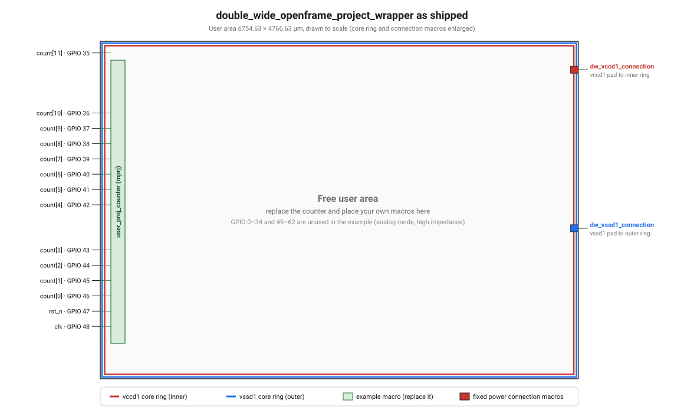

# The counter example

The template ships a working design: a 12-bit counter on the west-edge pads. It is there for one reason, to show how the wrapper is used. It is small enough to read in a few minutes and it touches everything a real design has to touch: pads, pad configuration, frame resets, power, hardening as a macro, simulation and precheck.

**It is not meant to be taped out. Replace it with your design** ([your_design.md](your_design.md)).



## What it does

| GPIO | Signal | Pad mode (`CF_gpio_config`) |
| :--- | :--- | :--- |
| 48 | `clk`, the counter's clock | 1, input |
| 47 | `rst_n`, active-low reset | 3, input with pull-up |
| 46 down to 35 | `count[0]` up to `count[11]` | 4, output |
| 0 to 34, 49 to 62 | unused | 0, analog (high impedance) |

These are the 14 pads of the west edge. GPIO indices run down that edge (35 at the top, 48 at the bottom) while the macro's pins run up it, which is why `count[i]` is on GPIO `46 - i`.

The counter counts on every rising clock edge. It is held at zero while any of three resets is active: the reset pad on GPIO 47, the frame's power-on reset `porb_l`, or the frame's master reset `resetb_l`.

## The two pieces

The design is split the same way `openframe_user_project` and `caravel_user_project` split theirs: logic goes in a macro, and the wrapper only wires it up.

### `user_proj_counter`, the macro

- RTL: `verilog/rtl/user_proj_counter.v`
- Hardening: `openlane/user_proj_counter/` (a 200 × 4000 µm block, 25 ns clock)

Things in it worth copying:

- **Power pins named for the wrapper's nets.** The macro's supply ports are `vccd1` and `vssd1`, inside `` `ifdef USE_POWER_PINS ``.
- **Reset release is synchronized.** All three resets are asynchronous. They assert the reset immediately, and a two-flop synchronizer releases it on the clock, so no flop sees a reset released too close to a clock edge. The SDC marks the reset inputs as false paths for that reason.
- **Pin order follows the pads.** `pin_order.cfg` puts `clk`, `rst_n` and `count[0..11]` on the macro's west side in the order of the pads beside it, and the two frame resets on the south side, so the wrapper's wires are short and do not cross.
- **Inputs are protected against antenna damage** with `DIODE_ON_PORTS: "in"`, because the wires from the pads are long.
- **Routing stops at metal 4** (`RT_MAX_LAYER`), leaving metal 5 free for the wrapper's power stripes to cross the macro and feed it.

### `double_wide_openframe_project_wrapper`, the wrapper

- RTL: `verilog/rtl/double_wide_openframe_project_wrapper.v`
- Hardening: `openlane/double_wide_openframe_project_wrapper/`

It contains:

1. **One instance of the macro**, `mprj`, placed at (150, 500) µm through the `MACROS` entry in `config.json`.
2. **One `CF_gpio_config` per pad, 63 in total**: one for the clock, one for the reset, twelve for the count outputs, and a `generate` loop that puts every remaining pad in analog mode. `CF_gpio_config` builds each pad's configuration from that pad's `gpio_loopback_one` and `gpio_loopback_zero` constants, so the wrapper needs no logic cells for it.
3. **The power grid**: a `vccd1`/`vssd1` core ring and stripes, the hook from the grid to `mprj` (`FP_PDN_MACRO_HOOKS`), and the two connection macros that tie the ring to the pads ([power.md](power.md)).

The wrapper has no standard cells of its own. It is hardened with `SYNTH_ELABORATE_ONLY`, which means "do not synthesize, just connect what is instantiated", and with the placement optimizations, clock tree synthesis and fill insertion turned off. Keep real logic in macros; this is what keeps a 32 mm² wrapper quick to harden.

`mask_rev`, `gpio_in_h`, `analog_io`, `analog_noesd_io`, `porb_h`, `por_l` and `resetb_h` are not used by the example.

## The test

`verilog/dv/cocotb/counter/counter.py` runs at chip level: the testbench drives the frame's pads, so the stimulus goes through the pad models, the power-on reset and the `resetb` pad before it reaches the wrapper. It checks that

- the count is zero while GPIO 47 is low,
- none of the 49 unused pads is driven,
- the counter advances by exactly one per clock after reset is released,
- the pull-up on GPIO 47 keeps the counter running when the pad is left undriven,
- the master reset pad resets the counter and it resumes afterwards.

```bash
cf verify counter
```

```bash
cf verify counter --sim gl
```

## Where each piece is recorded

When you replace the counter, these are the places that name it:

| File | Mentions of the example |
| :--- | :--- |
| `verilog/rtl/user_proj_counter.v` | The macro RTL |
| `verilog/rtl/double_wide_openframe_project_wrapper.v` | The `mprj` instance and the pad assignments |
| `openlane/user_proj_counter/` | Macro configuration, pin order, SDC |
| `openlane/double_wide_openframe_project_wrapper/config.json` | `MACROS.user_proj_counter`, `FP_PDN_MACRO_HOOKS` |
| `openlane/double_wide_openframe_project_wrapper/double_wide_openframe_project_wrapper.sdc` | Clock on `gpio_in[48]`, reset on `gpio_in[47]` |
| `verilog/includes/includes.rtl.openframe_user_project` | `rtl/user_proj_counter.v` |
| `verilog/includes/includes.gl.openframe_user_project` | `gl/user_proj_counter.v` |
| `lvs/double_wide_openframe_project_wrapper/lvs_config.json` | `gl/user_proj_counter.v` in `LVS_VERILOG_FILES` |
| `verilog/dv/cocotb/` | The `counter` test and the two test lists |
| `gds/`, `lef/`, `def/`, `lib/`, `spef/`, `mag/`, `verilog/gl/`, `signoff/` | The hardened `user_proj_counter` views |
